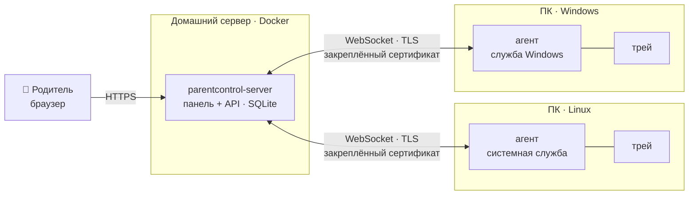

<div align="center">

# ⏳ parentcontrol

**Время на Minecraft и другие игры — одно на все домашние компьютеры.**<br>
Linux и Windows, управление с телефона через веб-панель в домашней сети.

[](LICENSE)


[Как это работает](#-как-это-работает) ·
[Сервер](#-сервер) ·
[Подключение ПК](#-подключение-компьютера) ·
[Границы защиты](#-чего-приложение-не-закрывает) ·
[Разработка](#-разработка)

</div>

---

## ✨ Возможности

- **Общая квота** — ребёнок не получит «ещё час» на соседнем компьютере.
- **Окна по дням недели** — например, будни 17:00–20:00, выходные с 10:00.
- **Честное предупреждение** — уведомления за 10, 5 и 1 минуту; игре
  предлагается закрыться и сохраниться, и только через 30 секунд она
  завершается принудительно.
- **Управление с телефона** — добавить, убавить или задать оставшееся время,
  заблокировать прямо сейчас. Изменения доходят до ПК за секунды.
- **История** — графики по дням, часы недели, устройства и сеансы.
- **Работает без сети** — агент продолжает считать время по последней
  полученной политике.
- **Minecraft не обмануть переименованием** — игра распознаётся по
  командной строке JVM, а не по имени `java.exe` или лаунчера.

## 🧭 Как это работает



| Компонент | Что делает |
|---|---|
| **Сервер** `parentcontrol-server` | Веб-панель родителя и API для агентов, данные в SQLite. Работает в Docker. |
| **Агент** `parentcontrol-agent` | Системная служба на детском ПК: видит процессы, считает время, закрывает программы. |
| **Трей** `parentcontrol-tray` | Значок и уведомления в сеансе ребёнка. Ничего не решает: если его закрыть, ограничения продолжают действовать. |

Родитель создаёт в панели **группы** программ (например, «Игры» со
встроенным правилом «Minecraft Java») и задаёт для каждой квоту минут и окна
разрешённого времени. Агент каждые 5 секунд ищет процессы групп среди
программ учётных записей, привязанных к ребёнку. Запуск в запрещённое время
пресекается сразу. Бюджетные сутки начинаются в 04:00 по часовому поясу
сервера.

## 🖥 Сервер

Нужен Linux-сервер с Docker в домашней сети.

### Запуск

```sh
git clone https://github.com/quantk/parentcontrol ~/parentcontrol
cd ~/parentcontrol/deploy
echo "PARENTCONTROL_BIND=192.168.1.10" > .env   # адрес сервера в домашней сети
docker compose up -d --build
```

Панель публикуется только на указанном адресе, порт `8443`. Часовой пояс и
начало суток задаются в [`deploy/compose.yaml`](deploy/compose.yaml)
(`PARENTCONTROL_TIME_ZONE`, `PARENTCONTROL_DAY_START`); они применяются при
первом запуске, дальше их меняют в панели («Настройки»).

### Пароль панели

Первый пароль задаётся только на самом сервере — чтобы ребёнок не успел
сделать это раньше родителя:

```sh
docker compose run --rm server set-password
```

Панель откроется по адресу `https://192.168.1.10:8443`.

> [!NOTE]
> Сертификат самоподписанный, поэтому браузер покажет предупреждение — это
> ожидаемо. Агенты не проверяют его по цепочке, а закрепляют по отпечатку.
> Свой сертификат подключается переменными `PARENTCONTROL_TLS_CERT` и
> `PARENTCONTROL_TLS_KEY`.

### Данные и обновление

База и сертификат хранятся в томе Docker `parentcontrol_data` и переживают
пересоздание контейнера. Обновление — `git pull && docker compose up -d --build`.

<details>
<summary>Резервная копия и журнал</summary>

```sh
docker run --rm -v parentcontrol_data:/data -v "$PWD":/backup alpine \
  tar czf /backup/parentcontrol-data.tgz -C /data .

docker compose logs -f server
```

</details>

<details>
<summary>Развёртывание с машины разработчика</summary>

Скопируйте [`.env.example`](.env.example) в `.env`, укажите SSH-адрес
сервера и адрес панели, затем:

```sh
just deploy
```

Команда отправляет закоммиченное дерево на сервер в `~/parentcontrol` и
выполняет там `docker compose up -d --build`. Данные остаются в томе.

</details>

## 💻 Подключение компьютера

1. В панели: **«Устройства» → «Получить код»**. Код действует 30 минут.
2. Установите агент (ниже) и выполните от имени администратора:

   ```sh
   parentcontrol-agent enroll --server https://192.168.1.10:8443 --code XXXX-XXXX
   ```

   Агент выведет отпечаток сертификата сервера — он должен совпасть с
   отпечатком на странице «Устройства».
3. В панели привяжите учётную запись ребёнка на этом ПК. Пока ни одна учётка
   не привязана, устройство помечено «не настроено» и ничего не ограничивает.

### 🐧 Linux (любой дистрибутив с systemd)

```sh
nix develop -c just dist-linux     # на машине разработчика → target/dist/linux
sudo ./install.sh                  # на ПК, из скопированной папки
```

Скрипт кладёт бинарники в `/usr/local/bin`, юнит — в `/etc/systemd/system`,
автозапуск трея — в `/etc/xdg/autostart` и включает службу. Данные агента —
в `/var/lib/parentcontrol`, доступ только у root. Журнал:
`journalctl -u parentcontrol-agent -f`.

Трей использует StatusNotifierItem: в KDE значок виден сразу, в GNOME нужно
расширение AppIndicator. Без него остаются уведомления.

### ❄️ NixOS

```nix
# flake.nix системы
inputs.parentcontrol.url = "github:quantk/parentcontrol";

# в модулях системы
imports = [ inputs.parentcontrol.nixosModules.default ];
services.parentcontrol.enable = true;
```

Модуль включает службу агента и автозапуск трея. Затем один раз выполните
`sudo parentcontrol-agent enroll …`.

### 🪟 Windows

Соберите программы на машине разработчика (`nix develop -c just dist-windows`
→ `target/dist/windows`), скопируйте `parentcontrol-agent.exe` и
`parentcontrol-tray.exe` в одну папку на ПК и в PowerShell от имени
администратора выполните:

```powershell
.\parentcontrol-agent.exe install
& "C:\Program Files\ParentControl\parentcontrol-agent.exe" enroll --server https://192.168.1.10:8443 --code XXXX-XXXX
```

`install` копирует программы в `C:\Program Files\ParentControl`, регистрирует
службу «Parent Control» (автозапуск, LocalSystem, перезапуск при сбое) и
автозапуск трея для всех пользователей. Данные и журнал `agent.log` — в
`C:\ProgramData\ParentControl`, доступ только у администраторов и SYSTEM.
Удаление: `parentcontrol-agent.exe uninstall` (данные сохраняются).

> [!IMPORTANT]
> Код под Windows проверяется автоматически только кросс-сборкой. Ручная
> проверка на реальном ПК описана в [docs/windows-checklist.md](docs/windows-checklist.md).

## 🛡 Чего приложение не закрывает

Защита опирается на то, что у ребёнка **нет прав администратора**. Вне зоны
ответственности приложения:

| Обход | Что сделать |
|---|---|
| Загрузка с флешки или другой системы | Пароль на BIOS/UEFI, запрет загрузки с USB |
| Пароль родительской учётки, гостевой вход | Без доступа к админской учётке; гостевой вход выключен |
| Minecraft на телефоне, приставке, чужом ПК | Ограничиваются только компьютеры с агентом |
| Программы, которых нет в правилах | Ограничивается только описанное в группах (чёрный список) |

Если два компьютера одновременно были без связи с сервером, общее время
может быть превышено. Это не наказывается, но видно в «Истории» (отметки
«офлайн» и «перерасход»).

## 🛠 Разработка

```sh
nix develop          # инструменты нужных версий
just check           # формат, clippy (Linux и Windows), тесты, сборка под Windows, cargo deny
just install-hooks   # запускать just check перед каждым коммитом
nix flake check      # пакет и VM-тест модуля NixOS
```

Без Nix нужны rustup (версию задаёт `rust-toolchain.toml`), `just`,
`cargo-deny`, а для Windows-проверок — mingw-w64.

```text
crates/
├── core     доменная логика: квоты, расписания, правила — без ОС и сети
├── agent    служба на детском ПК
├── tray     значок и уведомления
└── server   панель, API агентов, SQLite
```

Код, зависящий от ОС, живёт только в модулях `platform/` — это проверяет
`just check`.

Фикстуры распознавания Minecraft в
[`crates/core/tests/fixtures/minecraft`](crates/core/tests/fixtures/minecraft)
пока синтезированы по шаблонам лаунчеров; снимки реальных запусков
приветствуются — инструкция в README фикстур.

## 📄 Лицензия

[MIT](LICENSE)
